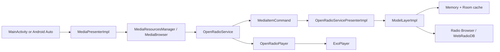

# FreeNetRadio Project Overview

FreeNetRadio is a Kotlin Android internet-radio client targeting phones, tablets, and Android Auto. It consumes station directories from [Radio Browser](https://www.radio-browser.info/) and [WebRadioDB](https://jcorporation.github.io/webradiodb/), then exposes browsing and playback through an Android Media3 `MediaLibraryService`.

The `app` module is a UI shell over shared networking, persistence, media-session, and playback code.

## Module structure

```text
common
  └── common-ui
       └── app          phone/tablet and Android Auto

android-jvm-stubs       test runtime only, never shipped
```

`settings.gradle` declares those three shipped modules and `android-jvm-stubs`, which reaches no
production artifact.

| Module | Responsibility |
| --- | --- |
| `common/` | Domain models, provider APIs, parsing, caching, persistence, playback, Media3 service, equalizer, location, timers, and broadcast receivers |
| `common-ui/` | Shared presenter, RecyclerView adapter base, dialogs, file import/export, logging, and service-command glue |
| `app/` | Phone/tablet UI and Android Auto metadata |
| `android-jvm-stubs/` | Working JVM implementations of the Android types unit tests need — `Uri`, `Bundle`, `MimeTypeMap`, the resource lookups of `Context`, and the `android.database.Observable` behind `RecyclerView.Adapter` notifications. `:common` and `:common-ui` take it as `testRuntimeOnly`, so tests compile against the real Android API and only the implementation is swapped at run time |

The application uses `applicationId` `com.github.jcszymansk.freenetradio`. Kotlin namespaces retain the recovered source package names; they do not define the installed application identity.

## Core architecture

The central component is `common/src/main/java/com/yuriy/openradio/shared/service/OpenRadioService.kt`, a Media3 `MediaLibraryService`. It owns:

- The `MediaLibrarySession`
- The browsable station hierarchy
- Station selection and playback
- Search and playback resumption
- Favorite commands
- Network-state handling
- Bluetooth reconnect and “becoming noisy” behavior
- Sleep-timer completion
- Custom commands from the application UIs

The service advertises both `android.media.browse.MediaBrowserService` and `androidx.media3.session.MediaLibraryService`. This lets the same content tree serve the phone UI, Android Auto, and other MediaBrowser clients. Native Android Automotive OS is out of scope and has no module.

### Runtime flow



A typical browse request follows this path:

1. `MediaPresenterImpl` creates a `MediaResourcesManager`.
2. `MediaResourcesManager` builds a Media3 `MediaBrowser` connected to `OpenRadioService`.
3. The UI requests children under a media ID such as root, countries, favorites, popular stations, or search.
4. `OpenRadioService` selects the corresponding `MediaItemCommand`.
5. The command calls `OpenRadioServicePresenterImpl`, which delegates to the provider and model layers.
6. Provider data is downloaded, cached, parsed into `RadioStation` values, and converted to Media3 `MediaItem`s.
7. `BrowseTree` retains the child items and their station mapping in memory.
8. Selecting a playable item causes the service to prepare and play it through `OpenRadioPlayer`.

`MediaResourcesManager.kt` is the client-side Media3 wrapper. It connects to the service with a `SessionToken`, requests library roots and children, listens for player state and metadata, and sends custom session commands.
The children it fetches reach the Activity only through `MediaPresenterImpl`, which drops an answer for any node but the top of its browse stack: a fetch can come back after the user has walked to another node.

## Browsable content model

`MediaId.kt` defines identifiers for:

- Root
- Categories and child categories
- Countries and country stations
- Favorites
- Local or user-defined stations
- Popular and new stations
- Search results
- The Android Auto browse node

Content generation uses a command pattern. Separate `MediaItemCommand` implementations produce major nodes such as `MediaItemFavoritesList`, `MediaItemCountriesList`, `MediaItemCountryStations`, and `MediaItemSearchFromService`. When the process starts in car mode, `OpenRadioServicePresenterImpl` answers the root with `MediaItemRootCar`, which keeps the top level short, and moves the remaining entries under `MediaItemBrowseCar`.

`BrowseTree.kt` is an in-memory cache mapping parent IDs to child `MediaItem` lists, corresponding `RadioStation` sets, and individual item lookups. Nodes are invalidated when favorites, sorting, source selection, or local stations change.

## Station providers and parsing

`SourcesLayer` selects the active provider.

### Radio Browser

`UrlLayerRadioBrowserImpl.kt` builds Radio Browser API requests for:

- Tags and categories
- Stations by tag or country
- Most-clicked stations
- Recently changed stations
- Search
- Country lists

It performs DNS discovery for available Radio Browser servers, caches discovered hosts, chooses one, and retains fallback mirrors. `ParserLayerRadioBrowserImpl` parses JSON results into `RadioStation` objects. Pagination uses a shared page size of 250.

### WebRadioDB

`UrlLayerWebRadioImpl.kt` uses static JSON datasets hosted through GitHub Pages:

```text
https://jcorporation.github.io/webradiodb/db/index/webradios.min.json
https://jcorporation.github.io/webradiodb/db/index/countries.min.json
```

Unlike Radio Browser, it downloads a whole dataset and applies category, country, or search filtering while parsing it.

### Stream and playlist handling

The project embeds William Seemann's JavaPlaylistParser with support for:

- M3U
- M3U8
- PLS
- ASX
- XSPF

This resolves station URLs that point to playlists rather than directly to audio streams.
`NetUtils.extractUrlsFromPlaylist` opens the station URL itself, because the content type it
declares is part of how the format is recognised. Every playlist that one names in turn (an ASX
`ENTRYREF`, or an entry whose URL has a playlist extension) is read through the service's
`DownloaderLayer` behind the parsers' `PlaylistFetcher`; the parsers open no connection of their
own and load no external XML entity. One `AutoDetectParser` per resolution remembers the URLs it
has followed and stops a chain at `AutoDetectParser.MAX_DEPTH`. A fetched playlist is dispatched
on its extension and then on its first bytes, and an entry without a playlist extension is kept as
a stream. HLS is left to the player: an entry whose URL ends in `.m3u8` is kept as a stream, and a
URL found to serve HLS only by reading it, the station URL included, is answered with itself and
the HLS MIME type. Each `ResolvedStream` carries its type to the player, because the player picks
its media source from the type before the URL.

Reading a station's playlist counts as playing it, so the mobile-network policy applies to it.
`extractUrlsFromPlaylist` asks the policy before every request, redirect hops included, and,
through `GatedInputStream`, before every read of a response, so a transfer already under way stops
too. A `NetworkPermit` remembers the first refusal, and the read then answers
`PlaylistRead.Blocked`. The service revokes the permits of its reads under way when the policy
pauses the station, which disconnects a read still waiting on a server that holds its answer
back. A blocked read, and a read still under way at that pause, end the `PlaylistFallback`
request; the station resumes from its own URL on a network it may use and reads its playlist
again.

## Playback

`OpenRadioPlayer.kt` wraps:

- Media3 `ExoPlayer` for device playback

The ExoPlayer path supports HLS and DASH alongside ordinary internet-radio streams. Buffer sizes are configurable through preferences; `MainAppCommon` validates them at startup and restores Media3 defaults when their ordering is invalid.

Other playback facilities include:

- ICY stream metadata
- Persisting and restoring the last station
- Mobile-network playback restrictions
- Bluetooth auto-resume
- Pause on audio-output disconnection
- Master-volume control
- Sleep timer
- Android hardware equalizer support

`EqualizerLayerImpl` binds Android's `audiofx.Equalizer` to the ExoPlayer audio session and persists band state through `EqualizerStorage`.

## Persistence and caching

The project deliberately uses several storage mechanisms for different data.

### SharedPreferences

Most settings and small domain collections use SharedPreferences through `AbstractStorage`:

- Favorites
- User-added or local stations
- Last played station
- Location and country choice
- Station provider choice
- Network preferences
- Sleep-timer state
- Equalizer state
- Buffering and general application settings

Stations are serialized to JSON and stored under station IDs.

### Room

Room databases have two bounded uses:

- Station artwork in `ImagesDatabase`
- Persistent API responses in `PersistentApiDb`

API responses have an in-memory first-level cache and a Room-backed second-level cache with a 24-hour expiry. Artwork is exposed through the custom `ImagesProvider` content provider.

### File storage

`FileStoreManager` provides user-driven import and export of favorites and local stations. Account login, cloud synchronization, telemetry, automatic crash reporting, and the hosted featured-stations feed have been removed.

## Dependency wiring

There is no dependency-injection framework. `DependencyRegistryCommon`, `DependencyRegistryCommonUi`, and platform registries manually construct singleton objects and inject them through `configureWith()` interfaces.

At startup, `DependencyRegistryCommon.init()` creates the main object graph:

- Provider URL and parser layers
- Downloader
- In-memory and Room API caches
- Model layer
- Station storages
- Image persistence
- Equalizer
- Network monitor
- Sleep timer
- Radio-station manager
- Service presenter

It also reads the UI mode once, at startup, to tell whether the process runs in a car; that choice selects the car root described above.

## Supported platforms

### Phone and tablet: `app/`

The entry points are `MainApp.kt` and `MainActivity.kt`. `MainActivity` is a single-instance `AppCompatActivity` using a drawer/navigation layout. It provides:

- Station and category browsing
- Search
- Equalizer
- Add, edit, and remove operations for local stations
- General, network, and stream-buffer settings
- Sleep timer
- About information

Its list adapter supports swipe-to-reveal station actions. The manifest also advertises Android Auto compatibility. Android Auto connects directly to the shared `OpenRadioService`; it does not use a separate projected-car Activity.


## Android components and permissions

The shared manifest registers:

- `OpenRadioService`
- `LocationService`
- `ImagesProvider`
- AndroidX `FileProvider`

Permissions cover internet and network state, wake lock, coarse location, foreground media playback, Bluetooth state and connection, and external image access. Android's platform `LocationManager` is used to choose a likely local country without Google Play Services. The 15.0.0 baseline no longer ships the offline country-boundary dataset used by earlier revisions.

The shared application manifest enables cleartext traffic. `ImagesProvider` is not exported: the app reads artwork in its own process, and `OpenRadioService` grants the Android Auto browser read access to the artwork uri of each item it browses.

## Build and release

| Component | Version |
| --- | ---: |
| Gradle wrapper | 8.2 |
| Android Gradle Plugin | 8.2.2 |
| Kotlin | 1.9.10 |
| KSP | 1.9.0-1.0.13 |
| JVM target | Java 8 |
| Compile and target SDK | 34 |
| Mobile minimum SDK | 17 |
| Media3 | 1.2.1 |
| `androidx.media` | 1.6.0 |
| Room | 2.6.1 |
| OkHttp | 3.12.13 |

The wrapper version comes from `gradle/wrapper/gradle-wrapper.properties`, KSP from the root
`build.gradle`, and the rest from `constants.gradle`. OkHttp and `androidx.media` are pinned to the
last versions compatible with API 17. `AGENTS.md` names the JDK and Android SDK a fresh clone builds
with.

The configured release version is `15.0.0`; `version.properties` contains version code `716`. The application ID is `com.github.jcszymansk.freenetradio` and the user-visible name is FreeNetRadio. Mandatory private signing configuration has been removed: debug builds use Android's standard debug key, while release builds remain unsigned until the project creates its release signing key.

Historical APKs are retained under `app/store/`. No continuous-integration workflow is present under `.github`; release signing and version advancement are developer-run Gradle tasks.

## Tests and project state

The repository contains these test classes, counted as files holding JUnit `@Test` methods:

| Source set | Runs on | Classes | Subject |
| --- | --- | ---: | --- |
| `common/src/test` | JVM | 56 | Playlist parsers, URL and parser layers, API caches, the model layer, browse commands and `BrowseTree`, media IDs and media-item building, station serialization and validation, sorting and filtering, network policy and recovery, playback state and error classification, equalizer serialization, sleep timer, artwork grants |
| `common-ui/src/test` | JVM | 6 | `MediaPresenterImpl` browse stack and child delivery, `MediaItemsAdapter`, `ServiceCommander`, diagnostic report files |
| `android-jvm-stubs/src/test` | JVM | 4 | The stubs themselves: `Uri`, `Bundle`, `MimeTypeMap`, `Observable` |
| `app/src/androidTest` | Device | 42 | SharedPreferences storages, the Room API cache and its schema upgrade, `ImagesProvider` access, file import and export, receivers, `OpenRadioService` browse, search, playback, commands and recovery, `OpenRadioPlayer`, `MediaResourcesManager`, station dialogs, and end-to-end journeys through `MainActivity` |

The instrumented suite runs under `OfflineTestRunner`, which refuses to run on a device that
reports a network; the urls its fixtures hand the app point at loopback or at an unreachable
origin, never at a host name. The coverage gate `./gradlew verifyPureCoreCoverage`, part of
`./gradlew check`, holds the pure-core classes listed in `gradle/pure-core-coverage.tsv` to a
coverage floor; `doc/testing-roadmap.md` explains the rules.

Android Auto is covered where the app decides something for it: the car root and browse node on
the JVM, and the artwork grant to the Android Auto browser on the JVM and the device. No test runs
against an Android Auto head unit.

The project is licensed under Apache 2.0. `NOTICE` retains attribution for the embedded playlist parser, the formerly bundled country-boundary library, and Android Open Source Project material. The imported baseline is preserved from the original repository's January 2024 history; see `doc/source-provenance.md`.
